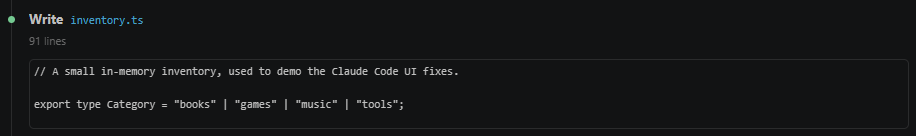
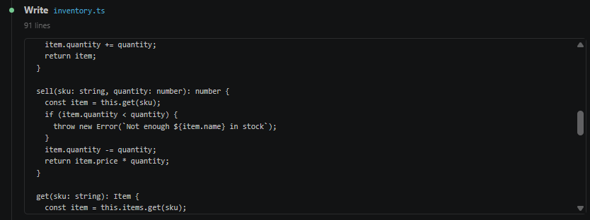
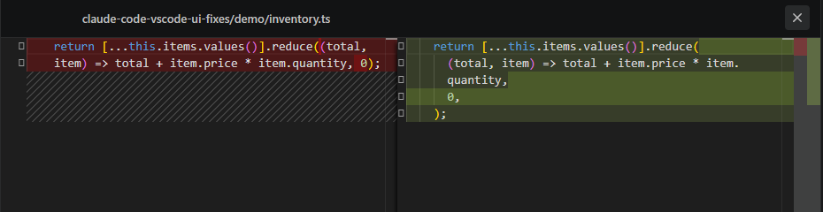
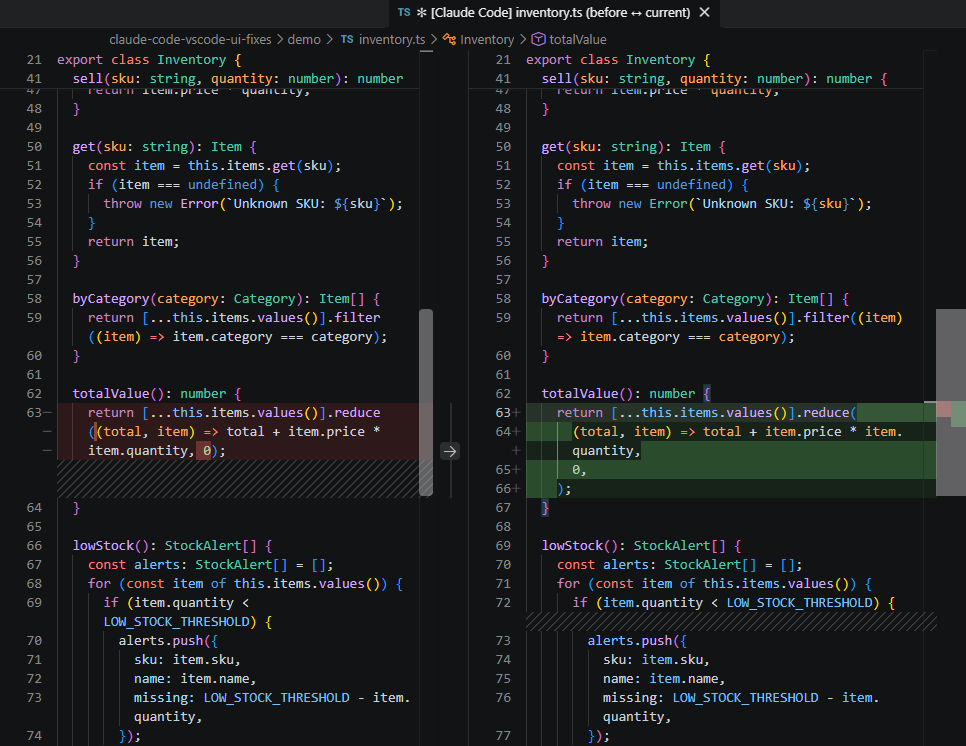
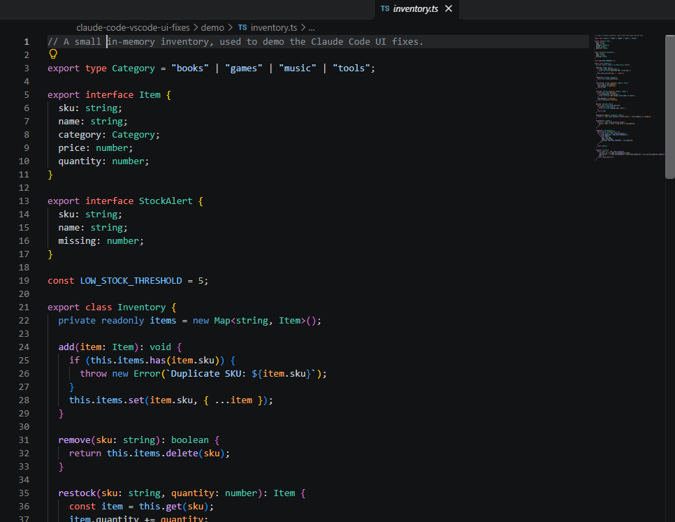
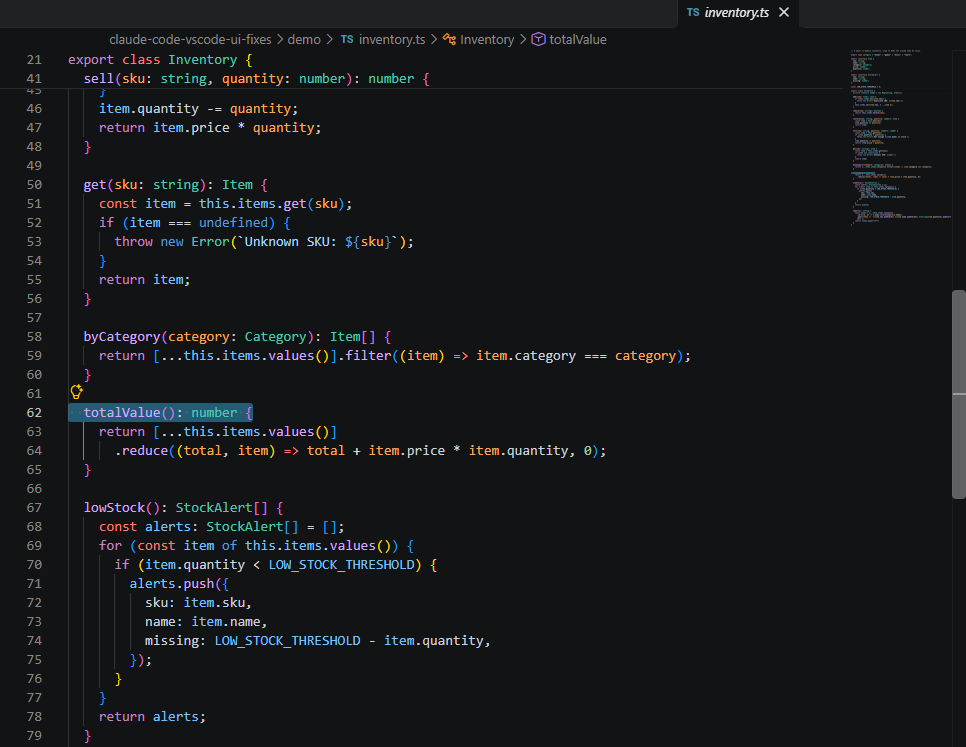
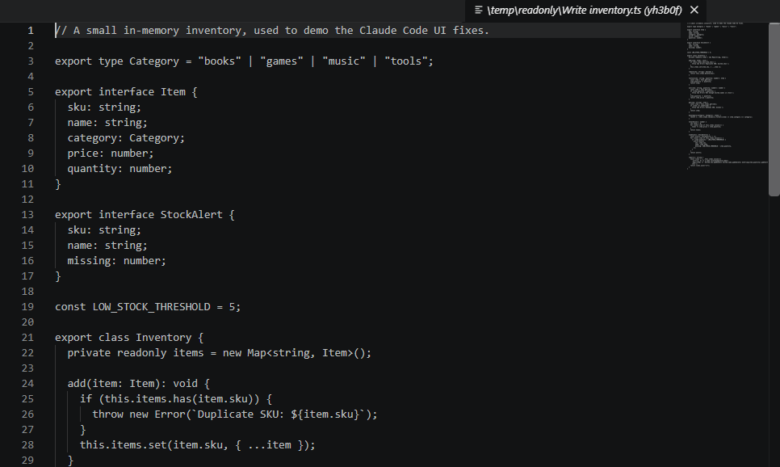
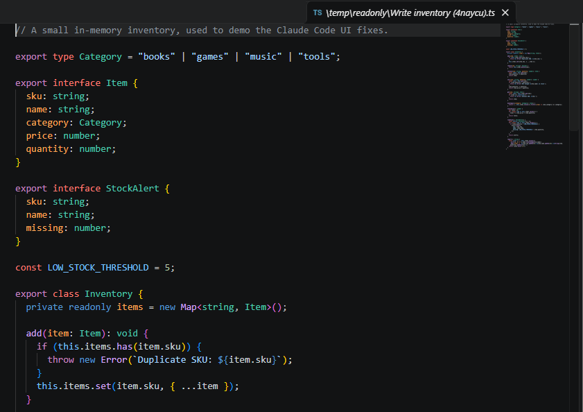
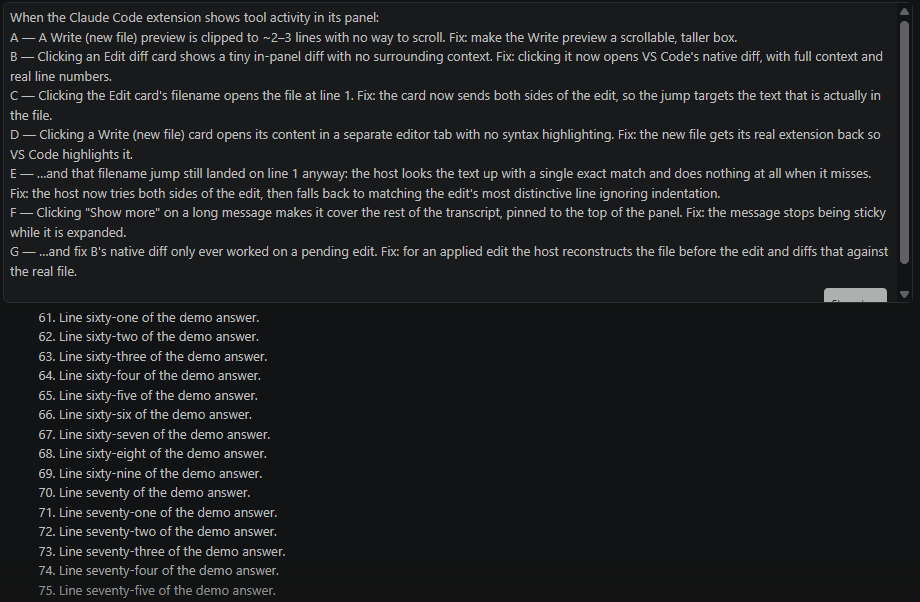
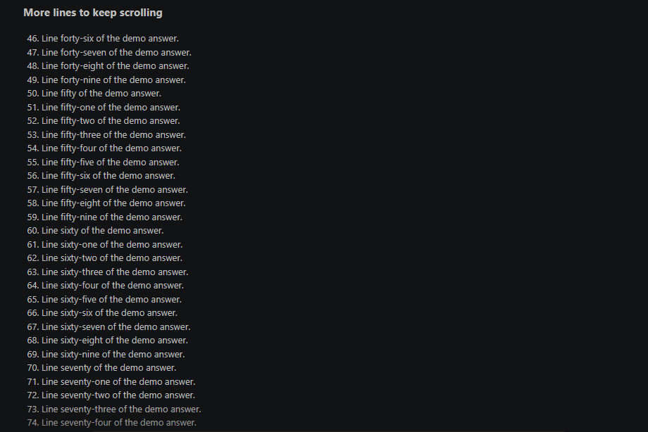

# claude-code-vscode-ui-fixes

Local patches for eight UX shortcomings in the **Claude Code VS Code extension**.

These are applied to the extension's bundles (webview + host) on *your own machine*.
The repo contains **only the patch script** — never any of Anthropic's code (see
[Legal](#legal)).

## The problems it fixes

When the Claude Code extension shows tool activity in its panel:

| # | Symptom | Fix |
|---|---------|-----|
| **A** | A **Write** (new file) preview is clipped to ~2–3 lines with no way to scroll. | Make the Write preview a scrollable, taller box. |
| **B** | Clicking an **Edit** diff card shows a tiny in-panel diff with no surrounding context. | Clicking it now opens VS Code's **native diff** (real file ↔ file-with-edit), with full context and real line numbers. Falls back to the original in-panel diff when neither side of the edit can be matched in the file. |
| **C** | Clicking the Edit card's **filename** looks the edit up by its new text only, so it finds nothing while the edit is still pending. | The card now sends both sides of the edit, so the jump targets whichever one is actually in the file. |
| **D** | Clicking a **Write** (new file) card opens its content in a separate editor tab with **no syntax highlighting** (everything is plain text). | The new file gets its real extension back so VS Code highlights it. |
| **E** | …and once the file has been reformatted or re-edited since the card, the host's single exact match misses and it does **nothing at all**: the file opens at line 1, or wherever its cursor last was — which can even look like a success. | The host tries both sides of the edit, then falls back to a single line of the edit, ignoring indentation, that still occurs **exactly once** in the file — the inserted text first. It lands on the edit after a reformat, and never on a look-alike line elsewhere; when no line is certain, it does not jump. |
| **F** | Clicking **"Show more"** on a long message keeps it pinned to the top of the panel while you read the answer below it. A message is a *sticky* header (so you keep seeing your question); expanded, it takes up to 40% of the panel's height, hiding a good part of the answer until you click "Show less" again. | The message stops being sticky while it is expanded, so it scrolls away with the rest of the transcript. Collapsed, it stays sticky as before. |
| **G** | …and fix B's native diff only ever worked on a **pending** edit. Click a card for an edit that is already applied — which is most of them — and you still got the tiny in-panel diff, because the host builds the diff by re-applying the edit to the file on disk, and the "before" text is gone from it. | For an applied edit the host now reconstructs the file *before* the edit (by applying it in reverse) and diffs that against the real file, so you get full context and the file's own line numbers either way. It only does so when it can place the edit with certainty — `old_string` gone from the file and `new_string` present exactly once — and otherwise leaves the click alone rather than point at a plausible wrong occurrence. |
| **H** | A tool card shows only the file's **name**, not its folder, so two files with the same name (a plan written to a temporary folder vs one in your repo) look identical until you click. | Hovering the file name on any card (Edit, Write, Read, Plan, NotebookEdit, sent files) now shows its **full path** as a tooltip. |

### Why patch locally instead of waiting for upstream?

The matching GitHub issues
([#59305](https://github.com/anthropics/claude-code/issues/59305),
[#59078](https://github.com/anthropics/claude-code/issues/59078),
[#3143](https://github.com/anthropics/claude-code/issues/3143),
[#48258](https://github.com/anthropics/claude-code/issues/48258),
[#65311](https://github.com/anthropics/claude-code/issues/65311))
were all auto-closed by `github-actions[bot]` as duplicate/stale/not-planned — none
got human triage. Self-patching is currently the only reliable path.

## Before / after

Each pair was taken on the same build, with `claude-ext-repatch.sh --restore` for the left side
and the patcher for the right one.

### A — Write preview

The preview of a new file: clipped to a few lines, versus a taller box you can scroll.

| Before | After |
|---|---|
|  |  |

### B + G — Clicking an Edit card

What a click on the diff card of an already-applied edit opens: the small in-panel diff, versus
VS Code's native diff with the whole file and its own line numbers.

| Before | After |
|---|---|
|  |  |

### C + E — Clicking the filename on an Edit card

A card whose text has been reformatted since: the file opens at line 1, versus on the edited method.

| Before | After |
|---|---|
|  |  |

### D — Opening a new file from its Write card

The editor tab opened from a Write card: plain text, versus highlighted as its language.

| Before | After |
|---|---|
|  |  |

### F — "Show more" on a long message

Reading a long answer under an expanded message: the message stays pinned over it, versus scrolls away.

| Before | After |
|---|---|
|  |  |

## How it works

The extension ships **minified, closed-source** bundles: the webview
(`webview/index.{js,css}`, fixes A/B/C/F/H) and the extension host (`extension.js`,
fixes D/E/G). Fix B reuses an RPC the extension **already implements** internally
(`open_diff` → `vscode.diff`) but never wires to the diff card's click. Fix D moves
the random disambiguator the host appends to a new file's virtual name — from *after*
the extension (`Foo.php (a1b2c3)`, which VS Code can't recognize) to *before* it
(`Foo (a1b2c3).php`), so language detection — and therefore highlighting — kicks in.
Fix E rewrites the host's "reveal this text" step, which the filename click (fix C)
depends on. Fix G adds the already-applied case to fix B's diff, and is opt-in on a marker
the webview sends with the click, so the CLI's own `open_diff` still fails the way it
expects to. D, E and G are applied independently, so one broken anchor can't cost the others.
The script:

- patches **every extension root it finds**: the one inside WSL (`~/.vscode-server`, the
  `linux-x64` build, used by a project opened over Remote-WSL) *and* the Windows-side
  profiles reached through the drives WSL mounts (`%USERPROFILE%\.vscode`, the `win32-x64`
  build, used by a project opened from a Windows folder — that window never reads
  `~/.vscode-server` at all). The drive letters come from `/proc/mounts`, none is assumed;
  set `CLAUDE_EXT_WIN_HOME` to restrict the search to one Windows home. The two builds carry
  the same webview and host bundles, so the same anchors match on both;
- patches, **per root**, the **two highest-versioned** installed builds, and restores anything
  older to pristine. Two, not one: an extension update that lands while VS Code is running would
  otherwise strip the patches from the build your window is still executing — the webview
  re-reads its bundle from disk whenever the panel is hidden and shown, so the fixes vanish
  mid-session with no message;
- keeps a one-time pristine backup of each touched file (`index.js.orig`,
  `index.css.orig`, `extension.js.orig`);
- always re-derives from those backups, so it's **idempotent**;
- locates code by **structural** anchors: every name the minifier controls (component
  names, tool tags, handler vars, the short `e,t,i,n` locals) and every CSS-module class
  hash is *discovered* from the bundle, never written into the anchor — only source-level
  names (`original:`, `filePath:`, `old_string`, `openContent`, `"Write"`, …) are matched
  literally. Argument *positions* are discovered the same way, by reading the callee's own
  signature. If an anchor is missing or ambiguous (e.g. after a big upstream rewrite) it
  **skips that fix and prints `ABORTED`/`SKIPPED`** rather than corrupting the bundle;
- treats the webview fixes (A/B/C/F/H) and the host fixes (D/E/G) as **independent** — a
  failure in one leaves the others applied (B and C go together, as a click handler without
  its target is worse than none);
- verifies `node --check` on each patched JS bundle and rolls it back if it somehow
  doesn't parse.

## Install

```bash
git clone https://github.com/<you>/claude-code-vscode-ui-fixes.git
cd claude-code-vscode-ui-fixes
./install.sh
```

Then **fully reload VS Code**: `Cmd/Ctrl+Shift+P` → *Developer: Reload Window*
(a plain window reload doesn't always reload the extension host — a full restart is
the safe bet).

`install.sh` copies the patcher to `~/.local/bin/`, runs it once, and adds a
backgrounded login hook to `~/.profile` so the patches are **re-applied automatically
after an extension update** (it's a no-op when already patched).

### Manual use

```bash
claude-ext-repatch.sh              # patch now
claude-ext-repatch.sh --if-needed  # only patch what isn't already patched (used by the hook)
claude-ext-repatch.sh --restore    # put every bundle back to its pristine backup
```

`--restore` undoes all three bundles (both webview files *and* the host) in every root, which
is what you want for a "before" screenshot — leave the host patched and the "before" isn't
one. `claude-ext-depatch.sh` is just a wrapper around it, kept for the old name.

### Uninstall

```bash
./install.sh --uninstall
```

Removes the login hook and the installed script. To drop the patches themselves,
reinstall the extension (or restore each `webview/index.{js,css}.orig` and
`extension.js.orig`) and reload VS Code.

## Limitations (honest)

- **Runs from Linux / WSL2 only.** It patches both the WSL-side install and the Windows-side
  one (through `/mnt/<drive>/Users/…`), so a project opened from a Windows folder is covered
  — but the script itself is bash and expects those paths. A native Windows or macOS install,
  with no WSL in the picture, isn't handled.
- The `~/.profile` hook only fires when you open a **WSL shell**. If you work on a Windows
  folder and never open one, the Windows-side build is not re-patched after an extension
  update until you do (or until you run the script by hand).
- After an extension **update during a running VS Code session**, the new build is patched
  at your next login and the one your window is running keeps its patches, but you still
  need to reload/restart VS Code to actually load the new bundle.
- Fix B's native diff needs one side of the edit to still be in the file — the "before"
  text for a pending edit, the "after" text for an applied one (fix G). If the file has
  moved on since the card was produced, neither matches and the click falls back to the
  original in-panel diff.
- Anchor strings are tied to the minified bundle. A major upstream rewrite will make
  some fixes `SKIPPED` — that's the signal to re-locate them, not a breakage.
- The webview never receives the full file content (only the changed hunk), so an
  *inline* context preview is structurally impossible; only the host-side native diff
  (fix B) has real context.

## Legal

The Claude Code extension is `© Anthropic PBC. All rights reserved.` This repository
**does not contain or redistribute any of Anthropic's code**. It only ships a script
that edits, in place, a bundle you have already installed yourself. Run it at your own
risk; it backs up the original files before touching them. Not affiliated with or
endorsed by Anthropic.

## License

MIT — applies to the contents of this repository (the script and docs) only.
